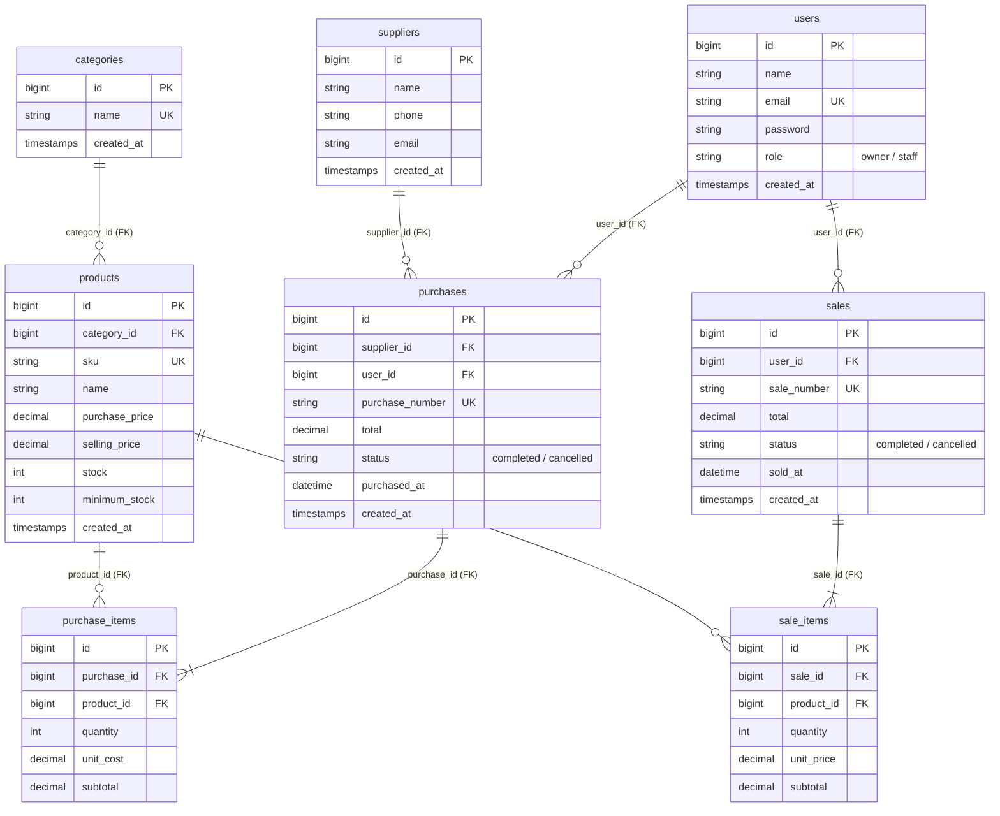

# Integrated Laravel Project: Inventory & Sales Management System

Aplikasi bisnis terintegrasi untuk manajemen inventaris, pemasok, transaksi pembelian (*stock-in*), dan transaksi penjualan (*stock-out*) dengan penegakan konsistensi stok otomatis, transaksi atomik database, serta kontrol akses berbasis peran (*Role-Based Access Control*).

Dikembangkan untuk memenuhi spesifikasi **Ujian Tengah Semester (UTS) Web Programming 2**.

---

## 1. Project Overview & Business Scenario

Sebuah usaha distribusi dan ritel kecil mengelola produk, kategori, pemasok, pembelian barang masuk, dan penjualan kasir melalui beberapa staf dan pemilik (*Owner*). Sistem ini menyelesaikan permasalahan pencatatan manual:
- **Konsistensi Stok Otomatis:** Stok fisik bertambah saat transaksi pembelian (*Purchase*) dan berkurang saat transaksi penjualan (*Sales*).
- **Pencegahan Overselling & Race Condition:** Sistem memeriksa ketersediaan stok menggunakan `lockForUpdate()` dan menolak transaksi jika stok tidak mencukupi tanpa ada data yang tersimpan setengah.
- **Kalkulasi Otoritatif Server:** Total harga dan subtotal dihitung di sisi server (PHP), tidak pernah mempercayai input manipulatif dari browser.
- **Atomisitas Transaksi (`DB::transaction`):** Header transaksi dan seluruh item transaksi disimpan dalam satu transaksi database. Jika ada satu item gagal, seluruh perubahan di-*rollback*.
- **Role-Based Access Control (RBAC):** Hak akses dibedakan secara tegas di tingkat server (*server-side middleware & authorization*) antara **Owner/Admin** dan **Staff**.
- **Aturan Pembatalan yang Aman:** Pembatalan transaksi penjualan mengembalikan stok barang ke gudang. Pembatalan pembelian menarik kembali stok, dengan validasi bahwa stok barang tersebut belum terpakai oleh penjualan.
- **Integritas Master Data:** Produk yang sudah pernah memiliki riwayat transaksi dilindungi dari penghapusan (*restrict delete*).

---

## 2. Akun Demo Uji Coba (Demo Credentials)

Sistem telah dilengkapi seeder akun demo siap pakai:

| Role | Email | Password | Hak Akses Utama |
|---|---|---|---|
| **Owner / Admin** | `owner@example.com` | `OwnerDemo2026!` | Akses Penuh: CRUD Master Data, Manajemen Pengguna & Role, Dashboard & Laporan, Pembatalan Transaksi |
| **Staff Gudang / Kasir** | `staff@example.com` | `StaffDemo2026!` | Lihat Katalog Produk, Input Transaksi Pembelian (*Stock-In*), Input Transaksi Penjualan (*Stock-Out*), Lihat Riwayat |
| **Staff Kasir Tambahan** | `kasir@example.com` | `StaffDemo2026!` | Transaksi Kasir Pembelian & Penjualan |
| **Pelanggan / User** | `user@example.com` | `UserDemo2026!` | **Toko Online:** Belanja Katalog Produk (`/shop`), Keranjang Belanja (`/cart`), Checkout (`/checkout`), Riwayat Pesanan (`/my-orders`) |

> [!TIP]
> Halaman login (`/login`) telah dilengkapi tombol pintas **"Pilih Akun Demo Uji Coba"** untuk mengisi akun Owner, Staff, atau Pelanggan secara instan dalam 1 klik. Pengunjung baru juga dapat mendaftar mandiri melalui menu **Daftar Akun Belanja** (`/register`).


---

## 3. Entity Relationship Diagram (ERD) & Relasi Data



### Penjelasan Relasi Eloquent:
1. `Category` **hasMany** `Product`, dan `Product` **belongsTo** `Category`. Foreign key `category_id` terletak pada tabel `products`.
2. `Supplier` **hasMany** `Purchase`, dan `Purchase` **belongsTo** `Supplier`. Foreign key `supplier_id` terletak pada tabel `purchases`.
3. `Purchase` **hasMany** `PurchaseItem`, dan `PurchaseItem` **belongsTo** `Purchase`.
4. `Product` **hasMany** `PurchaseItem`, dan `PurchaseItem` **belongsTo** `Product`.
5. `Sale` **hasMany** `SaleItem`, dan `SaleItem` **belongsTo** `Sale`.
6. `Product` **hasMany** `SaleItem`, dan `SaleItem` **belongsTo** `Product`.
7. `User` **hasMany** `Sale`, dan `Sale` **belongsTo** `User`.
8. `User` **hasMany** `Purchase`, dan `Purchase` **belongsTo** `User`.
9. Menggunakan Eager Loading (`with(['supplier', 'user', 'items.product'])`) untuk mencegah masalah **N+1 Query**.

---

## 4. Fitur Utama Aplikasi

### A. Autentikasi & Otorisasi Berbasis Peran
- Login, Remember Me, Logout, dan Session Regeneration.
- Server-side middleware `role:owner` untuk proteksi endpoint sensitif (bukan sekadar menyembunyikan tombol di UI).
- Staff yang mencoba mengakses URL admin (misalnya `/users` atau `/categories/create`) langsung dihentikan dengan status HTTP `403 Forbidden`.

### B. Master Data (Kategori, Produk, Pemasok)
- **Kategori:** Tambah, edit nama (validasi unik), hapus kategori (dilindungi bila masih berisi produk).
- **Produk:** SKU unik, nama produk, kategori, harga beli, harga jual, batas minimum stok, dan stok fisik.
- **Pemasok (Supplier):** Nama perusahaan, telepon/WhatsApp, email, dan riwayat pesanan pembelian.
- **Pencegahan Hard Delete:** Produk atau supplier yang telah memiliki riwayat transaksi tidak dapat dihapus, mencegah data *orphan*.

### C. Transaksi Pembelian Stok (*Purchase / Stock-In*)
- Memilih supplier dan tanggal transaksi.
- Mendukung **multi-item dinamis** dalam satu form transaksi (tambah baris / hapus baris dinamis via JavaScript).
- Stok barang langsung bertambah otomatis pada database saat transaksi tersimpan.
- Fitur pembatalan transaksi oleh Owner yang memvalidasi bahwa stok yang ditarik belum terpakai oleh penjualan.

### D. Transaksi Penjualan (*Sales / Stock-Out*) & Alur Pembatalan
- Kasir memilih barang dari dropdown dengan indikator stok aktual *real-time*.
- Validasi input di sisi klien dan server: transaksi ditolak jika kuantitas melebihi stok yang tersedia.
- Mendukung **multi-item dinamis** dengan kalkulasi subtotal dan grand total secara langsung.
- Penyesuaian stok dilakukan secara atomik menggunakan `lockForUpdate()`.
- **Alur Pembatalan Pesanan oleh Pembeli & Konfirmasi Owner:**
  - Pembeli dapat mengajukan permohonan pembatalan pesanan melalui halaman detail struk dengan menyertakan alasan. Status berubah menjadi `pending_cancel`.
  - Sistem menampilkan notifikasi badge dan banner peringatan di Dashboard dan menu Penjualan untuk Owner.
  - Owner meninjau alasan pembatalan dan dapat **Menyetujui** (stok barang dipulihkan ke gudang secara otomatis dalam transaksi atomik) atau **Menolak** (status pesanan tetap `completed`).
- Owner juga dapat membatalkan transaksi penjualan secara langsung dengan pemulihan stok.

### E. Dashboard Analisis Grafik & Usability
- **Grafik Interaktif (Chart.js):**
  - **Line Chart 7 Hari Terakhir:** Membandingkan tren Omset Penjualan vs Pengeluaran Pembelian harian.
  - **Doughnut Chart Komposisi Kategori:** Visualisasi proporsi penjualan per kategori produk.
- KPI Ringkasan: Total Master Produk, Pembelian Selesai, Penjualan Selesai, Penjualan Hari Ini, Penjualan Bulan Ini, dan Total Produk Stok Menipis.
- Panel Peringatan Stok Menipis (*Low Stock Alert*): Menampilkan produk yang stoknya $\le$ minimum stock dengan tombol jalan pintas restock.
- Pencarian dan filter transaksi berdasarkan nomor PO/SO, tanggal, status (Completed, Pending Cancel, Cancelled), supplier, dan kategori produk.

### F. Modul Laporan Bisnis & Keuangan (/reports)
- Dilengkapi analisis komprehensif performa usaha:
  - **Total Omset Penjualan** & Jumlah Transaksi
  - **Total Pengeluaran Beli Stok (PO)**
  - **HPP (Harga Pokok Penjualan)** Modal Barang Terjual
  - **Estimasi Laba Kotor (*Gross Profit*)** & Margin Keuntungan (%)
  - **Tabel Peringkat Top 5 Produk Terlaris** berdasarkan kuantitas terjual
  - **Tabel Rincian Penjualan & Pembelian** dengan paginasi
- Filter fleksibel: *Hari Ini, Minggu Ini, Bulan Ini, Tahun Ini*, maupun *Custom Date Range*.
- Tombol **Cetak Dokumen Laporan / Export PDF** dengan layout khusus cetak (@media print).

---

## 5. Panduan Instalasi & Menjalankan Aplikasi

Pastikan sistem Anda telah terpasang:
- **PHP** $\ge$ 8.2 (dengan ekstensi `pdo_mysql`, `openssl`, `mbstring`)
- **Composer** $\ge$ 2.0
- **MySQL / MariaDB**

### Langkah demi Langkah:

```bash
# 1. Masuk ke direktori project
cd inventory-sales-app

# 2. Salin environment file jika belum ada
cp .env.example .env

# 3. Pastikan konfigurasi database di .env sesuai:
# DB_CONNECTION=mysql
# DB_HOST=127.0.0.1
# DB_PORT=3306
# DB_DATABASE=inventory_sales
# DB_USERNAME=root
# DB_PASSWORD=

# 4. Generate application key
php artisan key:generate

# 5. Jalankan migrasi dan seeder database
php artisan migrate --seed

# 6. Jalankan web server lokal Laravel
php artisan serve
```

Aplikasi siap diakses melalui browser pada alamat:
**http://127.0.0.1:8000**

---

## 6. Bukti Pengujian Otomatis (Automated Testing)

Project telah dilengkapi unit & feature test yang mencakup seluruh skenario wajib pada rubrik penilaian:

```bash
php artisan test
```

### Hasil Eksekusi Test (40 Passed, 134 Assertions):
- `CustomerShopTest` (Toko & Belanja Konsumen serta Alur Pembatalan):
  - `test_customer_can_register_new_account` (PASS)
  - `test_customer_login_redirects_to_shop` (PASS)
  - `test_customer_can_browse_shop_catalog` (PASS)
  - `test_customer_can_add_product_to_cart` (PASS)
  - `test_customer_cannot_add_more_than_available_stock` (PASS)
  - `test_customer_can_checkout_and_stock_is_deducted` (PASS)
  - `test_customer_can_view_order_history_and_detail` (PASS)
  - `test_customer_cannot_access_backoffice_management` (PASS)
  - `test_customer_can_request_cancellation_with_reason` (PASS)
  - `test_customer_cannot_request_cancellation_for_other_user_order` (PASS)
  - `test_owner_can_approve_cancellation_and_restore_stock` (PASS)
  - `test_owner_can_reject_cancellation` (PASS)
  - `test_staff_cannot_approve_or_reject_cancellation` (PASS)
- `ReportTest` (Laporan Bisnis & Analisis Finansial):
  - `test_owner_can_access_business_reports` (PASS)
  - `test_staff_can_access_business_reports` (PASS)
  - `test_reports_can_filter_by_period_presets` (PASS)
- `AuthTest`:
  - `test_guest_is_redirected_to_login_when_accessing_dashboard` (PASS)
  - `test_login_screen_can_be_rendered` (PASS)
  - `test_user_cannot_login_with_invalid_password` (PASS)
  - `test_owner_can_login_and_see_dashboard` (PASS)
  - `test_staff_can_login_and_see_dashboard` (PASS)
  - `test_user_can_logout` (PASS)
- `AuthorizationTest`:
  - `test_staff_cannot_access_user_management` (PASS)
  - `test_staff_cannot_cancel_purchase_or_sale` (PASS)
  - `test_staff_cannot_delete_category_or_supplier` (PASS)
  - `test_owner_cannot_demote_or_delete_their_own_account` (PASS)
- `ProductTest`:
  - `test_owner_can_create_and_update_product` (PASS)
  - `test_duplicate_sku_is_rejected` (PASS)
  - `test_negative_price_or_minimum_stock_is_rejected` (PASS)
  - `test_staff_cannot_create_or_delete_product` (PASS)
  - `test_product_used_in_transactions_cannot_be_deleted` (PASS)
- `TransactionStockTest`:
  - `test_purchase_increases_product_stock` (PASS)
  - `test_sale_decreases_product_stock` (PASS)
  - `test_sale_with_insufficient_stock_is_rejected_and_stock_remains_unchanged` (PASS)
  - `test_atomic_rollback_when_one_item_in_sale_fails` (PASS)
  - `test_owner_can_cancel_sale_and_stock_is_restored` (PASS)
  - `test_owner_can_cancel_purchase_and_stock_is_reduced` (PASS)
  - `test_purchase_cancel_rejected_if_stock_already_sold` (PASS)


---

## 7. Panduan Tanya Jawab Code Interview (Slide 24)

Berikut rangkuman penjelasan teknis untuk persiapan wawancara kode (*code interview*):

1. **Mengapa `Sale` memiliki relasi `hasMany` ke `SaleItem`?**
   - Transaksi penjualan menganut struktur *header-detail*. Satu struk penjualan (`Sale`) dapat memuat satu atau lebih barang yang dibeli pelanggan (`SaleItem`). Foreign key `sale_id` ditempatkan pada `sale_items` agar jumlah item bersifat fleksibel (*1-to-many*).

2. **Di mana sistem memastikan stok tidak menjadi negatif?**
   - Di dalam `SaleController::store()` sebelum pemotongan stok dilakukan:
     ```php
     $product = Product::whereKey($item['product_id'])->lockForUpdate()->firstOrFail();
     if ($qty < 1 || $product->stock < $qty) {
         throw ValidationException::withMessages(['items' => "Stok {$product->name} tidak cukup."]);
     }
     ```
   - Serta pada `PurchaseController::cancel()` untuk memastikan stok produk belum terpakai di bawah jumlah yang akan ditarik.

3. **Mengapa total penjualan dihitung di server?**
   - Untuk aspek keamanan integritas data finansial. Harga dan kuantitas dari input browser dapat dimanipulasi dengan mudah melalui inspect element/DevTools. Server mengambil harga resmi langsung dari tabel `products` di database dan melakukan perkalian serta akumulasi secara mandiri.

4. **Apa risiko jika pengurangan stok dilakukan di luar `DB::transaction`?**
   - Terjadinya data tidak konsisten (*partial save*). Jika header transaksi berhasil tersimpan namun penyimpanan item ke-2 gagal (misalnya karena server error atau koneksi putus), tanpa `DB::transaction` data header dan pemotongan stok item pertama tetap tertulis di database tanpa detail lengkap, menyebabkan stok fisik dan buku transaksi tidak cocok.

5. **Bagaimana mencegah Staff mengakses fungsi Admin melalui URL langsung?**
   - Menggunakan Route Middleware `role:owner` yang memeriksa role pengguna terotentikasi di sisi server. Jika role bukan `owner`, server segera mengeksekusi `abort(403)` sebelum controller dipanggil.

6. **Apa yang terjadi jika dua penjualan memproses stok produk yang sama hampir bersamaan?**
   - Digunakan klausul `Product::lockForUpdate()` di dalam transaksi. Transaksi database pertama akan mengunci (*pessimistic lock*) baris produk tersebut hingga selesai di-*commit*. Request kedua akan menunggu baris terbuka dan membaca stok terbaru, sehingga mencegah *race condition* dan *overselling*.

7. **Tunjukkan validasi SKU unik dan jelaskan peran constraint database.**
   - Validasi Laravel: `'sku' => 'required|string|max:50|unique:products,sku'`.
   - Constraint Database: `$table->string('sku', 50)->unique();`.
   - Peran: Validasi Laravel memberikan pesan *error* ramah pengguna di form, sedangkan constraint unik di level database MySQL menjamin bahwa tidak akan pernah ada dua baris dengan SKU sama sekalipun terjadi request konkuren serempak.

---

## 8. Lisensi & Hak Cipta

Project ini dikembangkan sebagai karya original untuk Ujian Tengah Semester Web Programming 2. Seluruh hak cipta dilindungi.
# project-UTS

